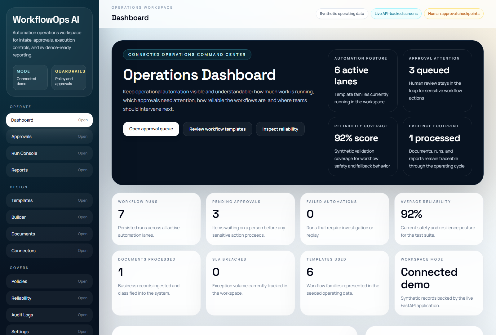
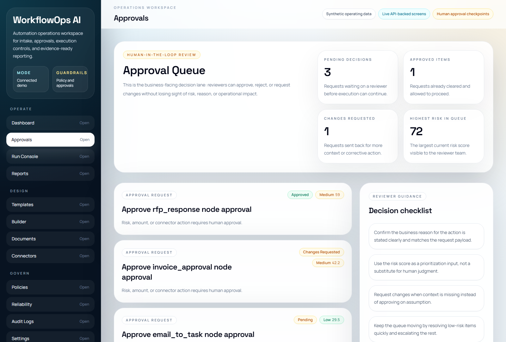
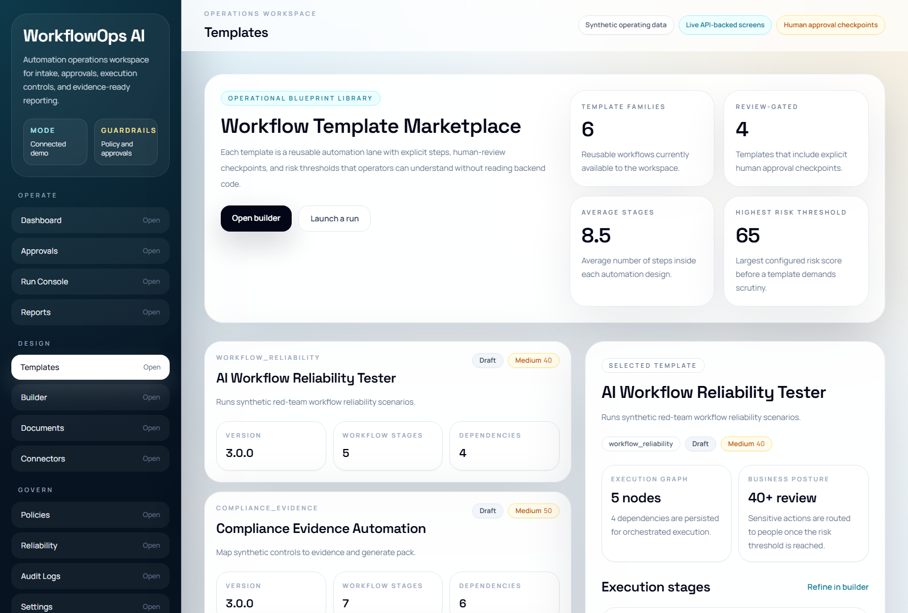
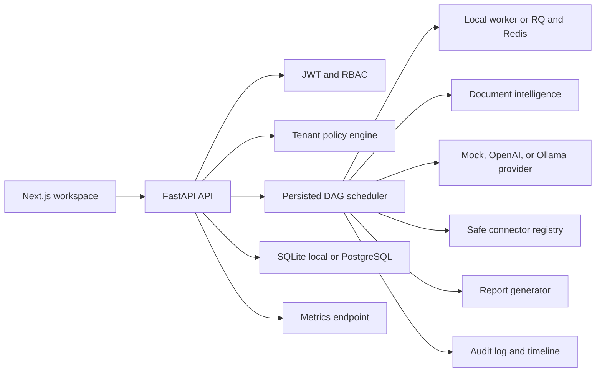
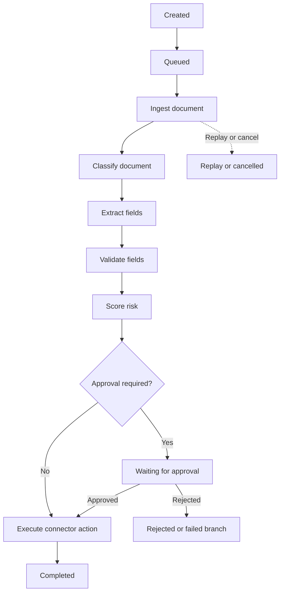
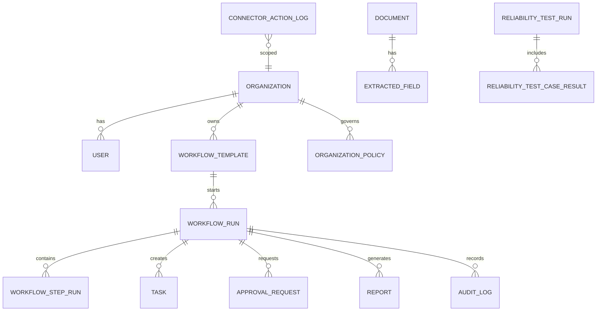
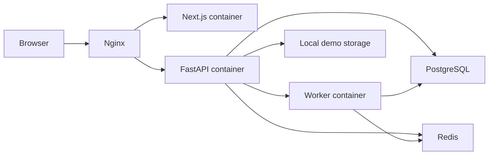

# WorkflowOps AI — Governed Workflow Automation Platform

[](https://github.com/HUSNAIN-MUNAWAR/workflowops-ai/actions/workflows/ci.yml)
[](#architecture)
[](#quick-start---local-sqlite)
[](#live-browser-screens)
[](docs/technical_deep_dive.md)

WorkflowOps AI is a governed automation platform for operations teams that need to turn invoices, emails, PDFs, RFPs, tickets, policies, and SOP-style documents into auditable workflow runs.

The stack combines document extraction, policy evaluation, approval gates, safe connector actions, reliability testing, reports, and a connected operator dashboard. The repository ships with synthetic business data and local-safe connector implementations so the full system can be run, tested, and demonstrated locally.

> Current scope: the repository is designed to be reproducible and honest. It includes connected demo data, real browser captures, persisted workflow state, and local validation paths. Production adoption would still require connector security review, secrets management, infrastructure hardening, monitoring, tenant isolation review, and domain-specific validation.

## Platform capabilities

| Area | Implemented in this repo |
|---|---|
| Workflow execution | Persisted DAG scheduler, node dependencies, snapshots, approval pauses, replay, cancellation |
| Background jobs | Local sync worker fallback plus RQ/Redis-ready queue interface and queue APIs |
| Persistence | SQLAlchemy models, SQLite local default, PostgreSQL Docker config, Alembic migration scaffold |
| Governance | RBAC, organization policy engine, approval thresholds, denied-action audit events |
| Connectors | Safe local demo connectors for email, notifications, sheets, CRM, accounting, webhooks, and storage |
| Reliability testing | `workflow_evalbench` with synthetic safety and resilience scenarios plus generated reports |
| Document intelligence | PDF extraction, optional OCR fallback, invoice and RFP extraction rules, confidence warnings, prompt-injection detection |
| Observability | Health, readiness, metrics, audit timeline, queue status, and connector metrics |
| Frontend | Next.js workspace for dashboard, runs, approvals, templates, builder, reports, connectors, policies, reliability, and audit logs |

## Live browser screens

The screenshots below are real Chromium captures from the running FastAPI and Next.js stack with connected synthetic business data.

| Dashboard | Approval queue |
|---|---|
|  |  |

| Reliability | Templates |
|---|---|
|  |  |

## Architecture



## Workflow lifecycle



## Data model



## Deployment reference



## Quick start - local SQLite

Create `.env` and `frontend/.env.local` from the example files before starting the stack.

```bash
python -m pip install -r backend/requirements.txt
cd frontend && npm install --no-audit --no-fund && cd ..

make db-upgrade
make seed

PYTHONPATH=backend uvicorn app.main:app --reload --host 0.0.0.0 --port 8000
cd frontend
NEXT_PUBLIC_API_URL=http://localhost:8000 npm run dev
```

Demo accounts:

- `admin@example.com` / `admin123`
- `reviewer@example.com` / `reviewer123`
- `viewer@example.com` / `viewer123`

## Main commands

```bash
make install             # backend + frontend dependencies
make db-upgrade          # Alembic upgrade
make seed                # synthetic demo seed
make dev                 # FastAPI backend
make worker              # local or RQ-ready worker
make test                # backend tests
make validate            # validation scripts
make reports             # sample reports
make screenshots         # data-derived preview screenshots
make screenshots-live    # Playwright browser captures for README assets
make frontend-check      # typecheck + build
make e2e                 # Playwright flow, requires browser tooling
```

## Docker

```bash
docker compose config
docker compose up --build
```

A production-style example is provided in `docker-compose.prod.example.yml` with Postgres, Redis, backend, worker, frontend, and nginx. It is an example deployment reference, not a hardened production stack.

## API surface

The FastAPI application covers auth, dashboard, workflow templates, workflow runs, approvals, documents, reports, reliability tests, audit logs, policies, connectors, queue status, health, readiness, and metrics.

Key endpoints:

- `POST /auth/login`, `GET /auth/me`
- `GET /workflow-templates`, `POST /workflow-runs`, `POST /workflow-runs/{id}/enqueue`, `POST /workflow-runs/{id}/resume`, `POST /workflow-runs/{id}/replay`
- `GET /approvals`, `POST /approvals/{id}/approve`, `POST /approvals/{id}/reject`, `POST /approvals/{id}/request-changes`
- `GET /connectors`, `POST /connectors/{id}/actions/{name}/dry-run`, `POST /connectors/{id}/actions/{name}/execute`
- `GET /policies/default`, `PUT /policies/default`, `POST /policies/evaluate`
- `GET /metrics`, `GET /queue/status`, `GET /queue/failed-jobs`

## Validation evidence from this workspace

```bash
PYTHONPATH=backend pytest -q backend/tests
# 19 passed, 2 warnings

PYTHONPATH=backend python scripts/validate_dag_scheduler.py
PYTHONPATH=backend python scripts/validate_background_worker.py
PYTHONPATH=backend python scripts/validate_connectors.py
PYTHONPATH=backend python scripts/validate_policy_engine.py
PYTHONPATH=backend python scripts/validate_invoice_workflow.py
PYTHONPATH=backend python scripts/validate_rfp_workflow.py
PYTHONPATH=backend python scripts/validate_support_workflow.py
PYTHONPATH=backend python scripts/validate_reliability_tests.py
PYTHONPATH=backend python scripts/validate_document_extraction.py
PYTHONPATH=backend python scripts/validate_security_controls.py
# all passed individually

cd backend && DATABASE_URL=sqlite:////tmp/workflowops_alembic_test.db PYTHONPATH=. alembic upgrade head
# passed

cd frontend && npm run typecheck && npm run build
# passed

cd frontend && npm run e2e
# passed

cd frontend && npm run screenshots:readme
# passed
```

Generated outputs:

- Reports: `sample_outputs/reports/`
- Validation JSON and Markdown: `sample_outputs/validation/`
- Data-derived preview screenshots: `sample_outputs/screenshots/*_connected_demo.png`
- Live browser screenshots: `sample_outputs/screenshots/*_live_browser.png`
- PDF render check: `sample_outputs/pdf_render_check_final/`

## Sample reports

`generate_demo_reports.py` creates six reports in JSON, Markdown, HTML, and PDF:

1. Invoice exception report
2. RFP compliance matrix
3. Compliance evidence pack
4. Customer escalation summary
5. Workflow reliability test report
6. Weekly automation operations report

## E2E status

Playwright coverage is included in `frontend/e2e/workflowops.spec.ts`. The README screenshots are generated by `frontend/scripts/capture-readme-screenshots.mjs` against the running local stack.

```bash
cd frontend
npx playwright install chromium
npm run e2e
npm run screenshots:readme
```

## Limitations

- All records and files are synthetic demo data.
- `MockLLMProvider` is deterministic and rule-based; optional OpenAI and Ollama adapters are extension points.
- Demo connectors write to local database tables or files only. They do not send emails, payments, chat messages, or live webhooks by default.
- OCR is lightweight and depends on optional Tesseract or PDF tooling plus document quality.
- RQ and Redis worker support is included, but this workspace validated local sync mode.
- Alembic migration coverage starts with an initial metadata migration and should be extended for long-lived production change management.
- This is not certified accounting, legal, SOC 2, ISO 27001, or compliance software.

## Roadmap

- Real connector OAuth flows and scoped credentials vault
- Tenant isolation hardening and deeper access-control review
- Production-grade worker orchestration and dead-letter queue tooling
- Incremental Alembic migrations with migration tests in CI
- Automated browser screenshot generation in CI from a running local stack
- Improved OCR and layout extraction with measured domain validation
- Cloud deployment reference with backup, restore, monitoring, and alerting

## Disclaimer

WorkflowOps AI demonstrates how governed AI automation can be structured with approvals, policies, auditability, and reliability checks before production hardening. It is not a certified compliance, accounting, legal, SOC 2, ISO 27001, or payment automation product.
