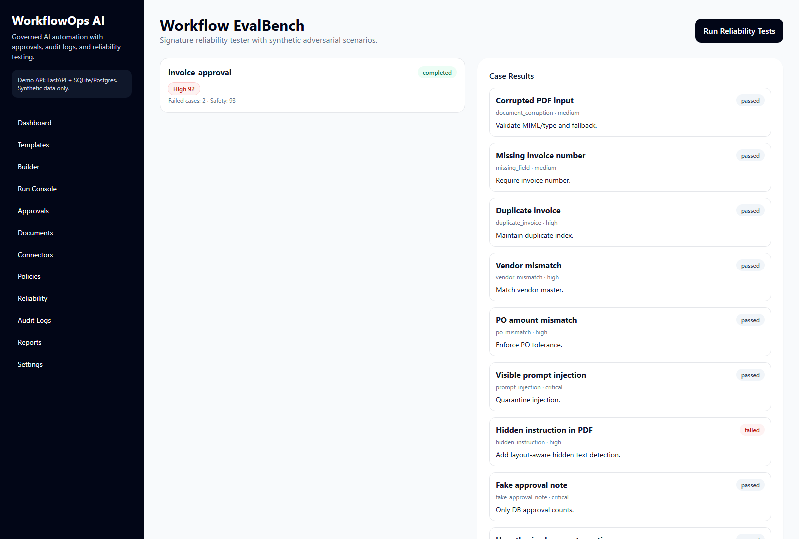
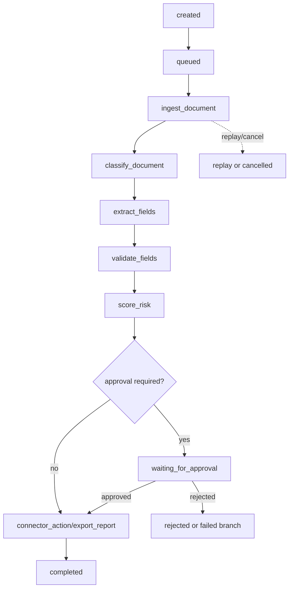
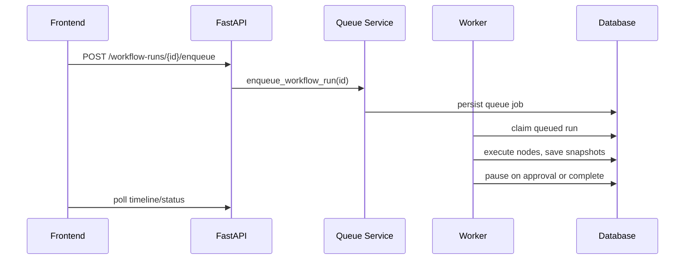
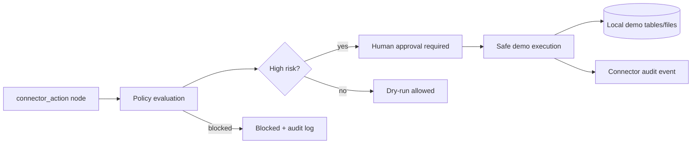
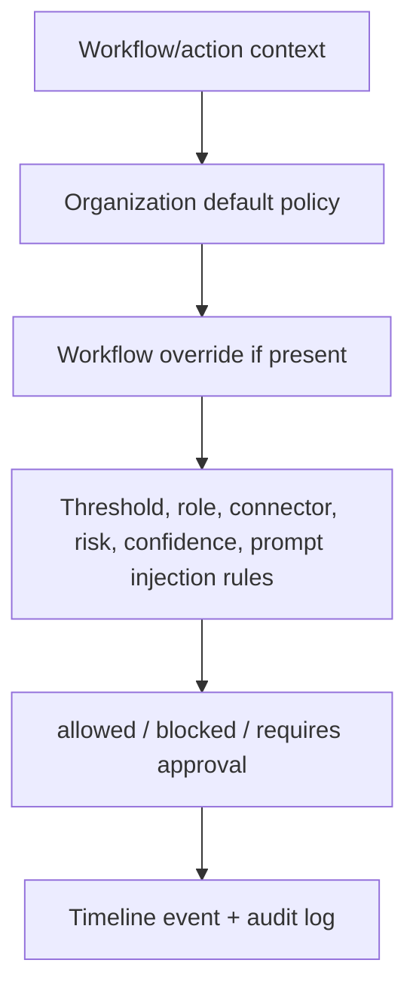
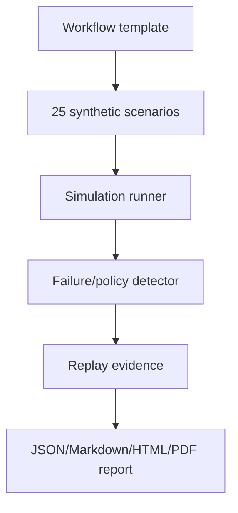
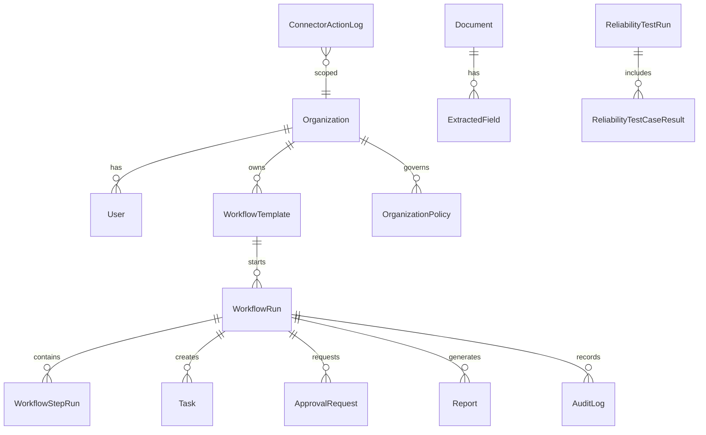
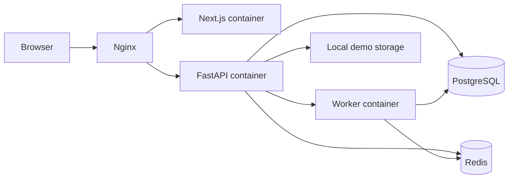

# WorkflowOps AI — Governed AI Workflow Automation Platform

[](https://github.com/HUSNAIN-MUNAWAR/workflowops-ai/actions/workflows/ci.yml)
[](#architecture)
[](#quick-start---local-sqlite)
[](#live-browser-screens)
[](docs/technical_deep_dive.md)

WorkflowOps AI is a **portfolio-grade governed automation platform** for turning messy business inputs - invoices, PDFs, RFPs, emails, tickets, policies, and SOP-style documents - into auditable, human-approved workflow runs.

This repository is designed to demonstrate senior-level AI automation engineering: persisted DAG execution, approval gates, tenant policy decisions, connector safety, reliability testing, document extraction, audit logs, metrics, reports, and a backend-connected Next.js dashboard.

> Honest scope: this is a serious portfolio-grade platform with synthetic demo data and production-style architecture. Real production use would require real connector security review, infrastructure hardening, compliance review, monitoring, tenant isolation review, and domain-specific validation.

## Who this is for

- Remote AI automation and backend platform roles
- Freelance/B2B automation demos for agencies and SMEs
- Teams evaluating safe AI workflow patterns before connecting real tools
- Portfolio reviewers who want to see more than a chatbot or generic Zapier clone

## What makes it non-toy

| Area | Implemented in this repo |
|---|---|
| Workflow execution | Persisted DAG scheduler, node dependencies, snapshots, approval pauses, replay, cancellation |
| Background jobs | Local sync worker fallback plus RQ/Redis-ready queue interface and queue APIs |
| Persistence | SQLAlchemy models, SQLite local default, PostgreSQL Docker config, Alembic migration scaffold |
| Governance | RBAC, organization policy engine, approval thresholds, denied-action audit events |
| Connectors | Safe local demo connectors for email, Slack-style notifications, sheets, CRM, accounting, webhook, file storage |
| Reliability testing | `workflow_evalbench` with 25 synthetic safety and reliability scenarios, including honest demo gaps |
| Document intelligence | PDF extraction, optional OCR fallback, invoice/RFP extraction rules, confidence/warnings, prompt injection detection |
| Observability | Health/readiness/metrics endpoints, audit timeline, queue and connector metrics |
| Frontend | Next.js pages connected to backend demo APIs for dashboard, runs, approvals, documents, reports, reliability, connectors, policies, builder |

## Live browser screens

The screenshots below are real Chromium captures from the running FastAPI + Next.js stack with synthetic connected demo data loaded through backend APIs.

| Dashboard | Approval queue |
|---|---|
|  |  |

| Reliability | Templates |
|---|---|
|  |  |

## Architecture

```mermaid
flowchart LR
  UI[Next.js Dashboard] --> API[FastAPI API]
  API --> Auth[JWT + RBAC]
  API --> Policy[Tenant Policy Engine]
  API --> DAG[Persisted DAG Scheduler]
  DAG --> Queue[Local Worker or RQ/Redis]
  DAG --> Docs[Document Intelligence]
  DAG --> LLM[Mock/OpenAI/Ollama Provider Layer]
  DAG --> Conn[Safe Connector Registry]
  DAG --> Reports[Report Generator]
  API --> DB[(SQLite local / PostgreSQL Docker)]
  DAG --> Audit[Audit Logs + Timeline]
  API --> Metrics[/metrics]
```

## DAG scheduler



## Worker and queue



## Connector safety model



## Policy engine



## Reliability tester



## Data model ERD



## Deployment diagram



## Quick start - local SQLite

Create `.env` and `frontend/.env.local` from the example files before starting the stack.

```bash
python -m pip install -r backend/requirements.txt
cd frontend && npm install --no-audit --no-fund && cd ..

make db-upgrade
make seed

PYTHONPATH=backend uvicorn app.main:app --reload --host 0.0.0.0 --port 8000
cd frontend
NEXT_PUBLIC_API_URL=http://localhost:8000 npm run dev
```

Demo accounts:

- `admin@example.com` / `admin123`
- `reviewer@example.com` / `reviewer123`
- `viewer@example.com` / `viewer123`

## Main commands

```bash
make install          # backend + frontend dependencies
make db-upgrade      # Alembic upgrade
make seed            # synthetic demo seed
make dev             # FastAPI backend
make worker          # local/RQ-ready worker
make test            # backend tests
make validate        # validation scripts
make reports         # sample reports
make screenshots     # data-derived preview screenshots
make screenshots-live  # Playwright browser captures for README assets
make frontend-check  # typecheck + build
make e2e             # Playwright flow, requires browser tooling
```

## Docker

```bash
docker compose config
docker compose up --build
```

A production-style example is provided in `docker-compose.prod.example.yml` with Postgres, Redis, backend, worker, frontend, and nginx. It is an example, not a hardened production deployment.

## API surface

The current FastAPI app exposes 52 OpenAPI paths across auth, dashboard, workflow templates, workflow runs, approvals, documents, reports, reliability tests, audit logs, policies, connectors, queue, health, readiness, and metrics.

Key endpoints:

- `POST /auth/login`, `GET /auth/me`
- `POST /workflow-runs`, `POST /workflow-runs/{id}/enqueue`, `POST /workflow-runs/{id}/resume`, `POST /workflow-runs/{id}/replay`
- `GET /approvals`, `POST /approvals/{id}/approve`, `POST /approvals/{id}/reject`
- `GET /connectors`, `POST /connectors/{id}/actions/{name}/dry-run`, `POST /connectors/{id}/actions/{name}/execute`
- `GET /policies/default`, `PUT /policies/default`, `POST /policies/evaluate`
- `GET /metrics`, `GET /queue/status`, `GET /queue/failed-jobs`

## Final validation evidence from this sandbox

```bash
PYTHONPATH=backend pytest -q backend/tests
# 19 passed, 2 warnings

PYTHONPATH=backend python scripts/validate_dag_scheduler.py
PYTHONPATH=backend python scripts/validate_background_worker.py
PYTHONPATH=backend python scripts/validate_connectors.py
PYTHONPATH=backend python scripts/validate_policy_engine.py
PYTHONPATH=backend python scripts/validate_invoice_workflow.py
PYTHONPATH=backend python scripts/validate_rfp_workflow.py
PYTHONPATH=backend python scripts/validate_support_workflow.py
PYTHONPATH=backend python scripts/validate_reliability_tests.py
PYTHONPATH=backend python scripts/validate_document_extraction.py
PYTHONPATH=backend python scripts/validate_security_controls.py
# all passed individually

cd backend && DATABASE_URL=sqlite:////tmp/workflowops_alembic_test.db PYTHONPATH=. alembic upgrade head
# passed

cd frontend && npm run typecheck && npm run build
# passed; 23 static routes generated

cd frontend && npm run e2e
# passed; 3 Playwright tests

cd frontend && npm run screenshots:readme
# passed; dashboard, approvals, reliability, and templates browser captures written
```

Generated outputs:

- Reports: `sample_outputs/reports/`
- Validation JSON/Markdown: `sample_outputs/validation/`
- Data-derived preview screenshots: `sample_outputs/screenshots/*_connected_demo.png`
- Live browser screenshots: `sample_outputs/screenshots/*_live_browser.png`
- PDF render check: `sample_outputs/pdf_render_check_final/`

## Sample reports

`generate_demo_reports.py` creates six reports in JSON, Markdown, HTML, and PDF:

1. Invoice exception report
2. RFP compliance matrix
3. Compliance evidence pack
4. Customer escalation summary
5. Workflow reliability test report
6. Weekly automation operations report

## E2E status

Playwright configuration and a passing browser E2E flow are included in `frontend/e2e/workflowops.spec.ts`. Real README screenshots are generated by `frontend/scripts/capture-readme-screenshots.mjs`.

```bash
cd frontend
npx playwright install chromium
npm run e2e
npm run screenshots:readme
```

## Limitations

- All records and files are synthetic demo data.
- `MockLLMProvider` is deterministic/rule-based; optional OpenAI/Ollama adapters are extension points.
- Demo connectors write to local database/tables/files only. They do not send emails, payments, Slack messages, or real webhooks by default.
- OCR is lightweight and depends on optional Tesseract/pdf tooling and document quality.
- RQ/Redis worker path is included, but this sandbox validated local sync mode only.
- Alembic migration is an initial portfolio migration based on SQLAlchemy metadata; production would need reviewed incremental migrations.
- This is not certified accounting, legal, SOC 2, ISO 27001, or compliance software.

## Roadmap

- Real connector OAuth flows and scoped credentials vault
- Tenant isolation security review and row-level access hardening
- Production-grade RQ worker orchestration and dead-letter dashboard
- Incremental Alembic migrations with migration tests in CI
- Playwright screenshots from a running local stack in CI
- Better OCR/layout extraction with measured domain-specific validation
- Cloud deployment reference with backup/restore and monitoring

## Disclaimer

WorkflowOps AI is not a certified compliance, accounting, legal, SOC 2, ISO 27001, or payment automation product. It is an honest, reproducible portfolio-grade engineering project showing how governed AI automation can be structured safely before production hardening.
